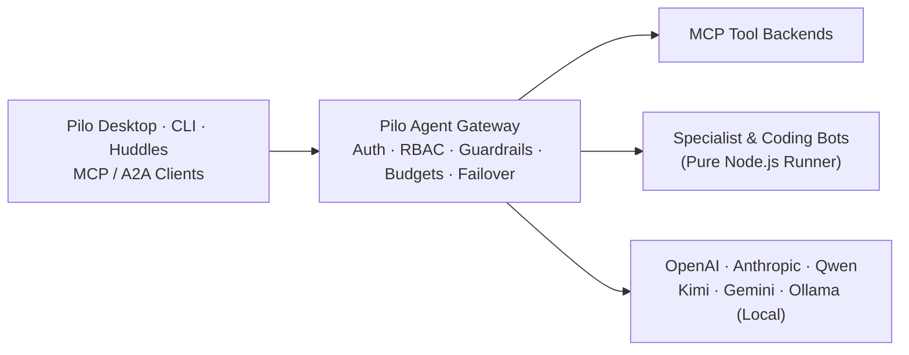

# Pilo

[](https://github.com/iamcharlesb/pilo/actions/workflows/ci.yml)
[](https://nodejs.org)
[](ROADMAP.md)
[](docs/agent-gateway.md)

**Pure Node.js AI Agent Runtime, Native Agent Gateway (MCP + A2A + Any Model), and Local Specialist Bots — Source-Available.**

[Gamifying Agent Thinking](docs/gamified-thinking.md): four-agent supervised practice with verified scoring, increasing challenge difficulty, and reviewed reusable instructions.


## Index

- [1. Quickstart](#1-quickstart)
- [2. Environment Setup (`.env`)](#2-environment-setup-env)
- [3. Slash Commands (`/help`)](#3-slash-commands-help)
- [4. Architecture & Agent Gateway](#4-architecture--agent-gateway)
- [5. Documentation Index](#5-documentation-index)
- [6. License & Creator](#6-license--creator)

---

## 1. Quickstart

Requires **Git** and **Node.js 22.12+**. Use `--recurse-submodules` (GitHub's "Download ZIP" omits the `node/browser_agent` app submodule).

```bash
git clone --recurse-submodules https://github.com/iamcharlesb/pilo.git
cd pilo
npm ci && npm --prefix node/browser_agent ci
npm --prefix node/browser_agent exec playwright install chromium
npm run desktop
```

Pilo opens at `http://127.0.0.1:8766`. Connect a model in **Settings (gear icon) → Connect a model provider**, or configure `.env` below.

---

## 2. Environment Setup (`.env`)

All model versions, endpoints, credentials, and runtime limits belong in gitignored `.env` files (never commit `.env` or paste keys in chat).

### A. Pilo Desktop & Bots (`node/browser_agent/.env`)

```bash
cp node/browser_agent/.env.example node/browser_agent/.env
```

| Variable | Required | Default / Example | Purpose |
| --- | --- | --- | --- |
| `BROWSER_AGENT_PROVIDER` | Yes | `openai`, `ollama`, `huggingface`, `deepseek`, `qwen`, `kimi`, `zhipu`, `minimax`, `yi`, `baichuan`, `doubao`, `stepfun`, `siliconflow`, `anthropic`, `xai`, `compatible` | Active model provider |
| `BROWSER_AGENT_MODEL` | Optional | *(blank)* | Explicit model override (leave blank to use provider preset) |
| `OPENAI_API_KEY` / `HF_TOKEN` / `DEEPSEEK_API_KEY` / `QWEN_API_KEY` / `KIMI_API_KEY` / `ZHIPU_API_KEY` / `MINIMAX_API_KEY` / `YI_API_KEY` / `BAICHUAN_API_KEY` / `DOUBAO_API_KEY` / `STEPFUN_API_KEY` / `SILICONFLOW_API_KEY` | One key (cloud) | *(secret)* | Fill only the key for your chosen cloud provider |
| `OLLAMA_MODEL` | If using Ollama | `llama3.2` or `qwen2.5-coder` | Pulled local Ollama model ID |
| `OLLAMA_BASE_URL` | If using Ollama | `http://127.0.0.1:11434/v1` | Local Ollama OpenAI-compatible endpoint |
| `OLLAMA_API_MODE` | If using Ollama | `chat` | Chat Completions mode for Ollama |
| `BROWSER_AGENT_MAX_STEPS` | Optional | `25` | Max tool steps per bot run |
| `BROWSER_AGENT_MAX_DURATION_SECONDS` | Optional | `900` | Max run duration in seconds (15 min) |
| `GOOGLE_CLIENT_ID` / `MONGODB_URI` | Optional | *(blank)* | Optional sign-in and cloud roster sync |

**Fastest local-only setup (Ollama, zero cloud keys):**
```dotenv
BROWSER_AGENT_PROVIDER=ollama
BROWSER_AGENT_MODEL=
OLLAMA_MODEL=qwen2.5-coder
OLLAMA_BASE_URL=http://127.0.0.1:11434/v1
OLLAMA_API_MODE=chat
```

### B. Pilo Runtime & Agent Gateway (root `.env`)

```bash
cp .env.example .env
```

| Variable | Example | Purpose |
| --- | --- | --- |
| `OLLAMA_MODEL` | `llama3.2` | Default model for `ChatOllama` / `OllamaLLM` |
| `OLLAMA_BASE_URL` | `http://localhost:11434` | Native Ollama API URL *(no `/v1` suffix)* |
| `OPENAI_MODEL` / `ANTHROPIC_MODEL` / `GEMINI_MODEL` | `gpt-4o`, `claude-3-5-sonnet-20241022`, `gemini-2.0-flash` | Explicit cloud model IDs |
| `OPENAI_API_KEY` / `ANTHROPIC_API_KEY` / `GEMINI_API_KEY` | *(secret)* | Cloud provider credentials |
| `MODEL_PRICING_JSON` | `{}` | Optional per-million-token pricing map |

> **Updating an existing clone:** `git pull && git submodule update --init --recursive && npm ci && npm --prefix node/browser_agent ci`

---

## 3. Slash Commands (`/help`)

Type `/help` directly in Pilo's chat composer or right-pane launcher (handled locally with **zero model cost**):

| Command | What it opens |
| --- | --- |
| `/help` | Full interactive Help index in the side pane |
| `/help setup` | First-time installation and launch checklist |
| `/help env` | `.env` configuration reference for cloud and local Ollama |
| `/help ollama` | Local Ollama setup, tool calling, and recommended coding models |
| `/help gateway` | Agent Gateway (MCP federation, A2A routing, RBAC, failover) |
| `/help commands` | All slash commands, shortcuts, and side-pane tools |
| `/learn <task>` | Rehearse a task and propose a reviewed playbook patch (built mode) |

---

## 4. Architecture & Agent Gateway

- **Pure Node.js Runtime**: Own execution loop (`nativeAgentRunner.ts`) supporting Responses API and Chat Completions API with zero `@openai/agents` SDK dependency.
- **Native Agent Gateway**: Unified MCP federation (`/mcp`), A2A Agent Cards & cancellable tasks (`/.well-known/agent.json`, `/a2a/*`), and LLM routing with automatic cloud-to-Ollama failover (`/v1/chat/completions`, `/v1/completions`).
- **Workspace Side-Pane**: Tabbed `Review` (git diff), `Open File`, `Terminal`, `Browser`, `Side Question`, `Plugins`, live `Subagents`, and `Background Tasks`.




---

## 5. Documentation Index

| Document | Contents |
| --- | --- |
| [docs/agent-gateway.md](docs/agent-gateway.md) | Agent Gateway setup, MCP/A2A endpoints, RBAC, and Ollama helpers |
| [node/browser_agent/docs/provider-setup.md](node/browser_agent/docs/provider-setup.md) | Complete provider setup, regional endpoints, and troubleshooting |
| [FEATURES.md](FEATURES.md) | Bot catalog, Huddles, Agent Gateway, and operating boundaries |
| [ROADMAP.md](ROADMAP.md) | Pilo Node.js runtime roadmap and engineering backlog |
| [CHANGELOG.md](CHANGELOG.md) | Recent changes and release history |
| [CONTRIBUTING.md](CONTRIBUTING.md) | Dev setup, test commands (`npm test`, `npm --prefix node/browser_agent test`), and guidelines |
| [node/browser_agent/docs/cli.md](node/browser_agent/docs/cli.md) | Terminal CLI usage without the desktop window |
| [tools/codex-wake/README.md](tools/codex-wake/README.md) | Standalone MIT-licensed MCP event observer and timeout runner |

*Named bots are independent AI assistants informed by public material, with no affiliation or endorsement from named people or firms. Financial analysis is informational only. See [operating boundaries](node/browser_agent/docs/buddy-bot-production.md).*

---

## 6. License & Creator

Pilo is licensed under the [Pilo Attribution License 1.0](LICENSE): free for personal, noncommercial, commercial, and enterprise use, with **required persistent credit** to Charles Barathidass including LinkedIn and X links (see [NOTICE](NOTICE)). Earlier Apache-2.0 releases retain their original permissions ([LICENSE-APACHE-2.0](LICENSE-APACHE-2.0)).

**Pilo — created by Charles Barathidass (@iamcharlesb)** · [GitHub](https://github.com/iamcharlesb) · [LinkedIn](https://www.linkedin.com/in/iamcharlesb/) · [X](https://x.com/iamcharlesb) · [Story on Medium](https://medium.com/@iamcharlesb/meet-pilo-inspired-by-grok-bots-and-chatgpt-dots-13a17c6c5e41)
