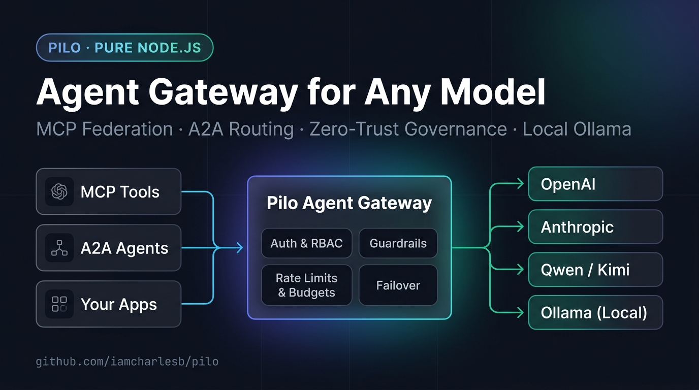
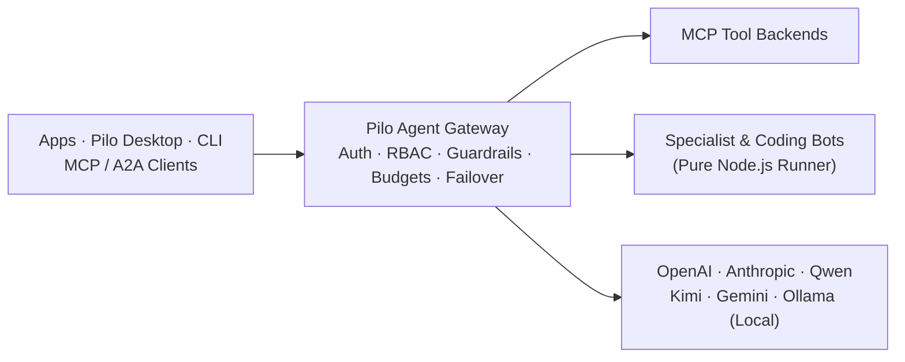

# Pilo

[](https://github.com/iamcharlesb/pilo/actions/workflows/ci.yml)
[](https://nodejs.org)
[](ROADMAP.md)
[](docs/agent-gateway.md)

[Agent Gateway](docs/agent-gateway.md) · [Roadmap](ROADMAP.md) · [Features](FEATURES.md) · [What has changed](CHANGELOG.md) · [Contributing](CONTRIBUTING.md)


**Pure Node.js AI Agent Runtime, Native Agent Gateway (MCP + A2A + Any Model), and Local Specialist Bots — Source-Available**

Pilo helps you delegate research, writing, coding, marketing, job-search preparation, and permitted browser actions to personal and specialist bots — powered by our own **pure Node.js agent runner** (no `@openai/agents` SDK lock-in) and a built-in **Agent Gateway** that routes **MCP tools**, **A2A agents**, and **any LLM** (OpenAI, Anthropic, Qwen, Kimi, Gemini, xAI, or local **Ollama**). It runs on your computer. Hosted model requests can still incur charges; reducing unnecessary token usage is a design goal, not a verified savings guarantee.

## Key Capabilities

- **Native Agent Gateway ([docs/agent-gateway.md](docs/agent-gateway.md))**: AI-native Node.js gateway for **MCP federation** (`/mcp`), **A2A discovery & cancellable tasks** (`/.well-known/agent.json`, `/a2a/*`), and **unified LLM routing** (`/v1/chat/completions`, `/v1/completions`) with automatic cloud-to-local **Ollama failover**.
- **Zero-Trust Security & Governance**: Fail-closed JWT & API-key auth, RBAC-filtered tool/agent/model discovery, pattern guardrails, sliding-window rate limits, pre-invocation token budgets, secret redaction, and automated secret scanning.
- **First-Class Local Ollama Support**: Native `ChatOllama` tool calling (`/api/chat` `tools`), JSON Schema structured outputs, `OllamaLLM` completions, `/api/tags` model discovery, and one-step Ollama agent registration.
- **Pure Node.js Execution Engine**: Supports both Responses API and Chat Completions API without `@openai/agents` (eliminating `--legacy-peer-deps`), with strict tool-arg validation, `finish_reason` / status checks, and `AbortSignal` cancellation.
- **Multi-Bot Huddles & DAG Workflows**: Run named Huddles across specialist bots, deterministic multi-step workflows, grounded coding bots (git-aware code index + hash-checked patching), and zero-token RSS/page/JSON watchers.





## Independent AI assistants

Named bots are AI assistants informed by public material. They are not the named people or employees of the named firms, and have no affiliation or endorsement from those people or firms, including Goldman Sachs, Google and Alphabet. Portraits identify public figures; they do not imply endorsement. Financial outputs are informational, not personalized financial advice. Verify sources, dates, assumptions and calculations before relying on them; returns are not guaranteed.

## Before you start

- Install Git and Node.js 22.12 or newer, with npm.
- The application lives in the separate **public** [iamcharlesb/browser-agent](https://github.com/iamcharlesb/browser-agent) submodule. Clone recursively to include it; no private-repository access is required.
- Have your chosen model provider credentials and model ID ready, or configure a local model. Google sign-in and MongoDB are optional.

## Quickstart (Install & Launch)

> **Important:** Use `--recurse-submodules` when cloning (GitHub's "Download ZIP" omits the `node/browser_agent` submodule).

```bash
git clone --recurse-submodules https://github.com/iamcharlesb/pilo.git
cd pilo
npm ci && npm --prefix node/browser_agent ci
npm --prefix node/browser_agent exec playwright install chromium
npm run desktop
```

The last command builds and opens Pilo in a desktop window (`http://127.0.0.1:8766`). Keep the terminal running while you use it. Both `iamcharlesb/pilo` and `iamcharlesb/browser-agent` are public and install cleanly with standard `npm ci` (no `--legacy-peer-deps` required).

## Connect a model

1. Open the gear icon → **Connect a model provider**.
2. Choose **OpenAI**, **Qwen**, or **Kimi**, paste that provider's API key, and click **Save settings**. Suggested models and endpoints are prefilled. For Qwen, confirm the endpoint matches your key's region.
3. Pilo selects the saved model. Use **Chat** and send a short test message; this makes a billable provider request. Saving settings makes no model request.

You can also configure an environment file:

```sh
cp node/browser_agent/.env.example node/browser_agent/.env
```

Edit `node/browser_agent/.env`, choose `BROWSER_AGENT_PROVIDER=openai`, `qwen`, or `kimi`, and fill **only** its `OPENAI_API_KEY`, `QWEN_API_KEY`, or `KIMI_API_KEY`. Leave `BROWSER_AGENT_MODEL` empty to use that provider's suggested model. Restart after editing the file manually. Never commit `.env` or paste credentials into chat.

[Complete first-time setup and provider guide](node/browser_agent/docs/provider-setup.md) covers prerequisites, API-key creation links, every setup step, regional endpoints, custom providers, browser modes, and troubleshooting. [Environment example](node/browser_agent/.env.example) lists all settings. Google sign-in and MongoDB are optional.

## Start your first task

1. Use **Primary Bot**, choose a specialist, or create a custom bot.
2. Start with a concrete task, such as “Draft a LinkedIn article about my project” or “Research these competitors and summarize the differences.”
3. Attach your project folder when asking for code changes.
4. For work in your signed-in browser, open **Connect Apps → Connect my Chrome** and follow the connection instructions.
5. Review requested approvals before allowing actions. Use **Stop** to cancel a run.

Start with a draft or research task so you can inspect the result before asking Pilo to take outward actions.

## Huddles

Use **New Huddle** in the sidebar to create a named session. Search the complete bot catalog, select participants, then choose **Create huddle**. The same catalog powers the main bot selector and includes built-in and custom bots. Selected bots are saved automatically when needed; you do not have to add them beforehand.

Ask a question in the huddle to gather each selected bot's perspective, show attributed replies, and produce a shared synthesis. Follow-up questions use the session's conversation history. Sessions remain in the sidebar and reopen without starting model work. Use **Edit huddle** to change the name or participants once its work finishes or is stopped.

Creating a huddle starts no model request. Sending a question may incur provider charges. Discussions and specialist research are read-only; the session does not authorize publication, transactions, or recurring jobs. The server's configured participant and time limits apply; failures and missing replies are reported explicitly. A configured conversational model is required.

## Update an existing installation

From the Pilo repository folder:

```bash
git pull
git submodule sync --recursive
git submodule update --init --recursive
npm ci
npm --prefix node/browser_agent ci
npm run desktop
```

Commit or save your local edits before updating. If a Pilo server is already running on port 8766, use `npm run desktop:attach` to open a window connected to it.

## Troubleshooting

| Problem | What to check |
| --- | --- |
| Application folder is empty | Run `git submodule update --init --recursive` to fetch the public app submodule. |
| Electron or TypeScript is missing | Run `npm --prefix node/browser_agent ci`. |
| Browser executable is missing | Run `npx playwright install chromium` from `node/browser_agent`. |
| Model does not respond | Check the selected provider, model ID, credentials, provider balance, and limits in Settings. |
| Google or Reddit blocks an automated browser | Use **Connect Apps → Connect my Chrome** with your own browser session. |
| Port 8766 is already in use | Reuse your running Pilo server with `npm run desktop:attach`. |

## More help and contributing

- [Codex Wake](tools/codex-wake/README.md): a standalone MIT-licensed MCP event observer and timeout runner for Codex, independent of the application submodule.
- [Application documentation](node/browser_agent/README.md): provider configuration, browser connection, approvals, and advanced setup.
- [CLI setup](node/browser_agent/docs/cli.md): terminal use without the desktop window.
- [Operating boundaries](node/browser_agent/docs/buddy-bot-production.md): current limitations and deployment details.
- [The story behind Pilo](https://medium.com/@iamcharlesb/meet-pilo-inspired-by-grok-bots-and-chatgpt-dots-13a17c6c5e41).
- [Report an issue](https://github.com/iamcharlesb/pilo/issues): include reproduction steps and remove credentials from logs.

Pilo is early stage. Contributions to reliability, usage efficiency, documentation, and security are welcome. Cloud execution and mobile access are roadmap items.

## License

Pilo is licensed under the [Pilo Attribution License 1.0](LICENSE): free for
personal, noncommercial, commercial, and enterprise use, with **required
persistent credit** to Charles Barathidass including LinkedIn and X links.

Redistributed copies, product UIs, About screens, and documentation must keep
the Required Notice lines in [NOTICE](NOTICE) and the credit:

**Pilo — created by Charles Barathidass (@iamcharlesb)** ·
[LinkedIn](https://www.linkedin.com/in/iamcharlesb/) ·
[X](https://x.com/iamcharlesb)

This is MIT-style in permissions but **not** the OSI MIT License, because of
the persistent attribution requirement. Earlier Apache-2.0 releases retain
their original permissions; see [LICENSE-APACHE-2.0](LICENSE-APACHE-2.0).
Third-party components retain their own licenses.

## Creator

**Charles Barathidass · [@iamcharlesb](https://github.com/iamcharlesb)** ·
[LinkedIn](https://www.linkedin.com/in/iamcharlesb/) ·
[X](https://x.com/iamcharlesb)
